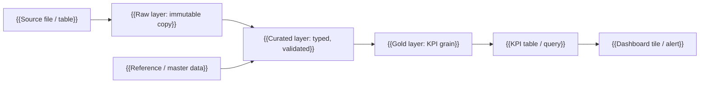
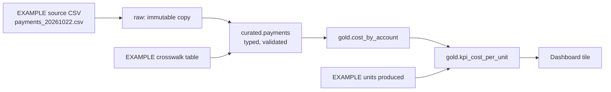

# Data lineage

<!--
TEMPLATE: the recorded path of every KPI number, from source column to dashboard tile. Fill it alongside the
transformations (silver and gold levels). Update it in the same pull request that changes a transformation.
Delete these comments and the EXAMPLE section when you add your own.
-->

Lineage answers one question in minutes instead of days: **"why does this number say X?"** It also answers "what breaks if the source changes this column?" (impact analysis) and "where does this sensitive field travel?" (privacy tracing).

Two depths:

| Level | Shows | Good for | Limit |
|---|---|---|---|
| Table level | Dataset A feeds dataset B | Quick map, ownership, outage impact | Cannot say which column caused a number |
| **Column level** (this page) | Column x of A, through a named rule, produces column y of B | Audit questions, impact analysis, privacy tracing | Harder to capture; every job must report it |

## 1. Column-level lineage table

One row per hop for every column that feeds a KPI. Keep the rule in plain words plus the check that protects it.

| Source (dataset.column) | Transformation (rule) | Target (dataset.column) | KPI it feeds | Check at this hop | Owner |
|---|---|---|---|---|---|
| `{{raw.table.column}}` | {{cast / rename / join / aggregate, with the rule}} | `{{curated.table.column}}` | {{KPI name}} | {{row count equals, control total, contract rule}} | {{role}} |
| | | | | | |

Rules for filling it:
- **Every KPI in [kpi-dictionary.md](kpi-dictionary.md) has at least one traced path** from the source file to the final column.
- **Say the rule, with a formula** ("SUM(amount) where type = PAYMENT, grouped by claim"), not "transformed".
- **Name the check** that proves the hop is correct, so reconciliation is part of lineage.
- **Mark sensitive columns** (see `classification` in [data-contract.yaml](data-contract.yaml)) and show where they are masked or dropped.

## 2. Flowchart template



## 3. How lineage is captured

| Source of truth | What it gives you | Cost |
|---|---|---|
| **Glue Data Catalog** | Table definitions and schemas: *what a table is*. By itself it does not say what produced it. | Included in the project cost cap |
| **Data contract** ([data-contract.yaml](data-contract.yaml)) | Source, owner and meaning of each input field | $0 |
| **This page** | The reviewed, human-readable column-level map and the rule at each hop | $0 |
| **Optional: OpenLineage-style JSON events written to S3** | Each job writes one small JSON event (start/finish, input datasets, output datasets, and which input columns feed each output column). Files in S3 can be queried later with Athena. | A few KB of S3; $0 in practice |

Capture pattern (optional, keep within the cost cap; no extra services):
1. Each Glue job / Lambda builds one event at the end of its run (`eventType: COMPLETE`) with `inputs`, `outputs` and a `columnLineage` facet.
2. It writes the event to `s3://<bucket>/lineage/<job>/<date>/<run_id>.json` (small JSON, no new service).
3. Event field names follow the OpenLineage specification as understood when this template was written. Check them against the current OpenLineage spec before relying on them.

## 4. EXAMPLE (illustrative, invented values)

**EXAMPLE: one payment from the source file to a KPI tile.** All names and numbers are invented for teaching.



| Source (dataset.column) | Transformation (rule) | Target (dataset.column) | KPI it feeds | Check at this hop | Owner |
|---|---|---|---|---|---|
| `raw.payments.amount` (text, "15600.00") | Cast to decimal(12,2); reject non-numeric | `curated.payments.amount` | Cost per unit | Control total of the file equals the sum, to the cent | Data engineering |
| `raw.payments.currency` | Validate against ISO 4217 list; convert to USD on payment date (rate 1 for USD) | `curated.payments.amount_usd` | Cost per unit | Unknown currency code goes to quarantine | Data engineering |
| `curated.payments.amount_usd` | `SUM(amount_usd)` where `type = 'PAYMENT'`, grouped by `account_id` | `gold.cost_by_account.paid_usd` | Cost per unit | Sum over all accounts equals ledger payments | Data engineering |
| `gold.cost_by_account.paid_usd`, `units_produced` | `SUM(paid_usd) / SUM(units_produced)` per month | `gold.kpi_cost_per_unit.cost_per_unit` | Cost per unit | Recompute in a separate script; difference ≤ tolerance | Business owner |

**Impact analysis from the same table:** if the source starts including tax in `amount`, find every row where `raw.payments.amount` is a source: it changes `curated.payments.amount_usd`, then `gold.cost_by_account.paid_usd`, then the `cost_per_unit` tile. The data-contract MAJOR-version process applies.

### EXAMPLE of an OpenLineage-style event (optional)

```json
{
  "eventType": "COMPLETE",
  "eventTime": "2026-11-02T06:14:09Z",
  "producer": "https://example.invalid/etl/gold-cost-by-account",
  "run": {"runId": "00000000-0000-4000-8000-000000000000"},
  "job": {"namespace": "example-project", "name": "gold.cost_by_account.build"},
  "inputs": [{"namespace": "s3://example-bucket", "name": "curated.payments"}],
  "outputs": [{
    "namespace": "s3://example-bucket",
    "name": "gold.cost_by_account",
    "facets": {
      "columnLineage": {
        "fields": {
          "paid_usd": {
            "inputFields": [{"namespace": "s3://example-bucket", "name": "curated.payments", "field": "amount_usd"}],
            "transformationDescription": "SUM(amount_usd) where type = PAYMENT, grouped by account_id"
          }
        }
      }
    }
  }]
}
```
